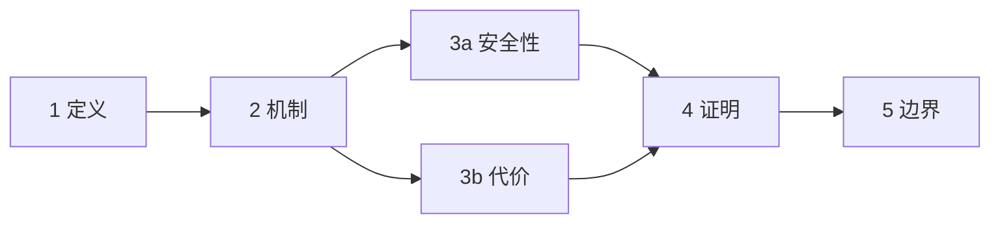

# 可复制模板

本文件是逐节讲解的固定块与变体（骨架页、定位块、检查点、收束页、修订块、存档块、算法实例、子节、改进方向、交接卡）。尖括号 `〈〉` 里的内容按实际情况替换，其余照抄即可。

## 1. 骨架页

### 4–6 节的标准版

```markdown
## 总体路线

一句话：这次要弄懂〈总问题〉。

**依赖**：1 〈功能名〉 → 2 〈功能名〉 → 3 〈功能名〉 → 4 〈功能名〉

| # | 本节 | 你会得到的结论 | 为什么排在这 |
| --- | --- | --- | --- |
| 1 | 〈功能名〉 | 〈一句话结论〉 | 先建立〈前提〉 |
| 2 | 〈功能名〉 | 〈一句话结论〉 | 用第 1 节的〈结论〉推出 |
| 3 | 〈功能名〉 | 〈一句话结论〉 | 承接第 2 节，回答〈子问题〉 |
| 4 | 〈功能名〉 | 〈一句话结论〉 | 收口，处理〈边界〉 |

共 4 节：第 1–3 节各 300–600 字，第 4 节含〈证明/推导〉约 800–1200 字；第 k 节依赖第 k−1 节，不能跳。

先不展开：加速与优化、采样与随机化、实现与调参——需要哪条说一声，我再单独讲。

要改分节、合并或跳过，现在说；没问题回「开始」。
```

### 3 节的短版

节少时可以不用表格，改用编号列表，省掉"为什么排在这"一列，但每节的结论必须写出来：

```markdown
## 总体路线

要弄懂〈总问题〉，分 3 节：

1. 〈标题〉——给出〈结论〉。
2. 〈标题〉——用第 1 节的结论解释〈机制〉。
3. 〈标题〉——处理〈边界/反例〉。

要改分节现在说；没问题回「开始」。
```

### 7 节以上的分层版

节多时先分层，层内再编号；每层写一句定位，避免路线图变成 12 行表格。

```markdown
## 总体路线

**A 层 · 是什么（第 1–3 节）**：把〈对象〉的定义、构成和前提讲清。
**B 层 · 为什么（第 4–6 节）**：解释〈机制〉为什么成立。
**C 层 · 边界（第 7 节）**：什么情况下会失效。

| # | 本节 | 结论一句话 |
| --- | --- | --- |
| 1 | 〈标题〉 | 〈结论〉 |
| 2 | 〈标题〉 | 〈结论〉 |
| 3 | 〈标题〉 | 〈结论〉 |
| 4 | 〈标题〉 | 〈结论〉 |
| 5 | 〈标题〉 | 〈结论〉 |
| 6 | 〈标题〉 | 〈结论〉 |
| 7 | 〈标题〉 | 〈结论〉 |

共 7 节，每节 300–600 字，A 层讲完会停一次确认。

要改分节现在说；没问题回「开始」。
```

### 有分叉或汇合时

节数 ≥5 或结构有分支时，先给 Mermaid，再紧跟缩进树；渲染不出来时读树。

````markdown


```text
1 定义
└─ 2 机制
   ├─ 3a 安全性 ─┐
   └─ 3b 代价   ─┴→ 4 证明 → 5 边界
```
````

只有一条链、又没有分支时，用一行箭头就够，不必上 Mermaid。

## 2. 节首定位块

标准版（位置示意一行 + 三行定位）：

```markdown
### 第 2 / 4 节 · 〈本节标题〉

`██░░░░░░ 2/4`　`1 → [2] → 3 → 4`

- 从哪来：第 1 节得到〈结论 A〉。
- 为什么现在：不先解决〈本节问题〉，第 3 节的〈步骤 B〉就没有立足点。
- 到哪去：本节的结论会作为第 3 节的输入。

本节目标：读完能用自己的话说出〈一个可检验的判断〉。
```

变体一：本节含代码。目标句改写成"读完能看懂下面这段代码为什么这样写"，正文给最小片段加逐行说明表：

```markdown
本节目标：读完能说出这段代码里〈关键行〉为什么不能省。
```

变体二：本节含公式推导。定位块不变，正文按"符号表 → 推导 → 结论"排列，推导超过三行时在节内再拆小节。

变体三：上层结构。7 节以上时，进度条后追加层名：

```markdown
`████░░░░ 5/7 · B 层 为什么`
```

## 3. 检查点

检查点只问一个问题，问题要针对本节最可能的误读，不要复述正文。

概念型（"是什么"）：

```markdown
**停一下**：如果只能说一句话，〈本节结论〉你会怎么说？
卡住就回「卡在〈某处〉」，我换一种讲法。
继续回「继续」；想跳过后面某一节，回「跳到第 j 节」（j 是后面的节号）。
```

同节换讲法时保留标题与进度条，标题后加「· 再讲一次」：

```markdown
### 第 2 / 4 节 · 分数的量级随维度变大（再讲一次）

`████░░ 2/4`

- 从哪来：……（三行定位照旧）
- 这次换的是：第 1 级，换一个例子。

〈新讲法的正文，结论不变〉

**停一下**：〈针对刚才卡点的同一个问题〉
```

方法型（"怎么做"）：

```markdown
**停一下**：给你一个〈新场景〉，你会先做哪一步，为什么不是另一头？
继续回「继续」；没想清就说「没懂 + 卡在哪」。
```

判断型（"选哪个"）：

```markdown
**停一下**：如果〈条件 X〉成立，结论还成立吗？说出一个会让它失效的条件。
继续回「继续」；想压缩后面几节，回「直接说结论」。
```

## 4. 收束页

```markdown
## 串起来

| # | 结论 |
| --- | --- |
| 1 | 〈结论〉 |
| 2 | 〈结论〉 |
| 3 | 〈结论〉 |
| 4 | 〈结论〉 |

一句话：〈总答案〉。

改进方向（算法、协议、系统设计类必给，见第 10 节）。

自测（可选）：〈3 道题〉。
要不要把这段整理成一册可独立阅读的文档？可以转 conversation-book。
```

## 5. 骨架修订块

用户要求改分节，或讲解中发现骨架不成立时使用。必须写清影响范围，否则已讲内容会悬空。

```markdown
**骨架修订**
- 旧：1 定义 → 2 机制 → 3 边界 → 4 结论
- 新：1 定义 → 2 机制（拆成 2a 直觉 / 2b 推导） → 3 边界 → 4 结论
- 原因：第 2 节的推导比预估重，混在直觉里会讲不完。
- 影响：第 1 节不用重讲；第 3、4 节编号顺延为 4、5。

按新骨架继续，回「继续」。
```

影响分三档，必须明确说是哪一档：

| 档位 | 含义 | 处理 |
| --- | --- | --- |
| 无影响 | 只是增删后面的节 | 直接继续 |
| 需回补 | 已讲结论被新结构改变 | 用一句话补上差异，再继续 |
| 需重讲 | 已讲的整节前提不再成立 | 明确说"第 k 节需要重讲一遍"，不偷偷覆盖 |

## 6. 存档块

用户说"先到这 / 下次接着讲"时输出，也可写成文件（用户指定路径或同意后）。

```markdown
**进度存档**
- 问题：〈总问题〉
- 已讲：第 1–3 节，结论分别是〈各一句〉
- 未讲：第 4–6 节
- 暂停区：P1 〈跑题问题〉、P2 〈另一个〉
- 已掌握：〈用户复述正确或被明确跳过的内容〉
下次说「接着讲」时，我按这份存档从第 4 节继续。
```

续讲时先给"续讲定位块"，不要重新出整张路线图：

```markdown
### 续讲 · 第 4 / 6 节 · 〈标题〉

上次停在第 3 节的〈结论〉；本次从第 4 节继续，暂停区还有 P1 待回收。
```

## 7. 算法的输入 / 输出块

算法类每节开头先给这两行，再进入机制；整个主题只定义一次。

```markdown
**输入**：〈消息 $m \in \mathbb{Z}_n$；公钥 $(n, e)$〉
**输出**：〈密文 $c \in \mathbb{Z}_n$〉
```

写法要求：

1. 输入写类型、尺寸或取值域（标量 / 向量 / 矩阵、$\mathbb{R}^d$、$\mathbb{Z}_n$），不要只写"一些数据"。
2. 输出写类型与含义；有多个输出就分行，标清哪个是主结果。
3. 记号在第一次出现时定死，后续节只引用；实例用同一组输入输出。
4. 只有两行，不写实现细节、不写复杂度——那些属于待问清单。

## 8. 算法实例块

放在机制之后、边界之前，只用来验证本节结论。

```markdown
**跑一遍**（最小参数）

输入：〈n = 4 的具体取值〉

1. 〈步骤〉→ 中间状态：〈…〉
2. 〈步骤〉→ 中间状态：〈…〉
3. 〈步骤〉→ 结果：〈…〉

对照本节结论：〈结果如何印证结论〉；〈一个会让它失败的输入〉。
```

要求：3–7 步；每步写中间状态；不引入新术语；不拿真实参数硬跑（256 位密钥、上千条数据）。用户说"跳过例子"就删掉这一块，不因此少讲机制。

实例里不展开加速、采样、并行实现——那些属于待问清单，放大实例里只会把人带离本节结论。

## 9. 子节（只在必须时）

```markdown
### 第 3 / 5 节 · 〈功能名〉

`████░░░░ 3/5`　`1 → 2 → [3] → 4 → 5`

- 从哪来：第 2 节得到〈结论〉。
- 为什么现在：〈…〉。
- 到哪去：〈…〉。

#### 3.1 〈这一小段必须单独交代的问题〉
〈正文〉

#### 3.2 〈另一小段〉
〈正文〉

一句话回收：〈本节结论〉。

**停一下**：〈一个问题〉
```

不设配额：没有必须单独交代的段落就不分子节；子节不新增主结论，整节仍只有一个检查点。

## 10. 改进方向

只在讲算法、协议、系统设计时给；每条一行，只写方向，不写实施步骤。

```markdown
### 改进方向

**可行**
- 〈改动〉→ 解决〈什么问题〉→ 代价：〈…〉
- 〈改动〉→ 解决〈什么问题〉→ 代价：〈…〉

**不可行**
- 〈改动〉→ 看似能解决〈…〉，但会破坏〈哪个假设〉／触发〈哪种已知攻击〉／代价涨〈多少〉

**待验证**
- 〈改动〉→ 先验证〈第一步〉
```

可行 2–4 条、不可行 2–3 条；不可行的必须写清为什么不行，不能只写"不推荐"。

## 11. 交接卡（另开新会话用）

用户选中某条建议后生成，让他复制到新会话；没选中就不生成。

```markdown
**背景卡：〈建议名〉**

- 已讲内容：〈算法／协议〉，核心结论〈一句话〉
- 已确认的参数与约束：〈…〉
- 这条建议要回答的问题：〈…〉
- 建议的起点：第 1 节回答〈…〉，之后按功能分节
- 沿用方式：先给骨架页，确认后一次只讲一节
```


## 12. 对比块

凡是"A 与 B 怎么选""两者差在哪"，都用并排表；维度做行、对象做列，差异处标「▲」。

```markdown
一句话：〈在什么条件下谁更好〉。

| 维度 | 〈A〉 | 〈B〉 |
| --- | --- | --- |
| 〈维度 1〉 | 〈取值〉 | **〈取值〉** ▲ |
| 〈维度 2〉 | 〈取值〉 | 〈取值〉 |
| 〈维度 3〉 | **〈取值〉** ▲ | 〈取值〉 |

▲ 标的是差异点；相同项不强调。超过 4 列就拆成两张表，或先按类分组。
```

规则：

1. 先给一句结论，再给表；表不承担结论，只承担证据。
2. 同一行只放同一维度，行序按重要性排，不按字母序。
3. 差异用加粗或「▲」，全表统一一种标法；不要既加粗又画箭头又换颜色。
4. 不要用"先说 A……再说 B……"的两段式，让读者自己横向对照。
